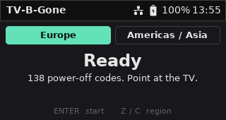
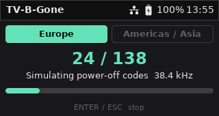

# ZeroTVBGone

[TV-B-Gone](https://www.tvbgone.com/) para el [M5Stack Cardputer Zero](https://docs.m5stack.com/en/CardputerZero):
se apunta a una tele, se pulsa `Enter` y el LED infrarrojo del aparato va mandando, uno detrás
de otro, los códigos de apagado de casi todas las marcas. En el lanzador se llama **TV-B-Gone**.

<p>
  
  
</p>

Es una adaptación del TV-B-Gone original de Mitch Altman y Limor Fried (el
[kit de Adafruit](https://github.com/adafruit/TV-B-Gone-kit), firmware 1.2): los códigos son los
suyos, sin tocar. Está hecha sobre la [plantilla oficial](https://github.com/CardputerZero/Template)
del Cardputer Zero (LVGL 9.5 + CMake), así que se ve y se maneja como el resto de apps del
aparato: barra de título con hora, red y batería, tema claro u oscuro, ayuda con `Fn`+`H` y
captura con `Fn`+`J`.

## Qué hace

- **Dos listas**, como el original: **Europe** (138 códigos; vale también para Oceanía y Oriente
  Medio) y **Americas / Asia** (137). Cada una va de las teles más vendidas a las menos, así que
  lo normal es que la tele se apague en los primeros segundos. La región elegida se recuerda.
- **Una pasada dura algo menos de un minuto.** La pantalla dice por qué código va y a qué
  frecuencia; se puede parar en cualquier momento.
- Como el original, **sólo apaga si se deja de emitir a tiempo**: en muchas teles el código de
  apagar es el mismo que el de encender. Lo suyo es parar en cuanto se apague.
- Si el aparato no tiene el emisor de infrarrojos activo, o no deja usarlo, lo dice en pantalla.

## Teclas

Las flechas del Cardputer Zero están en `F`, `Z`, `X` y `C`: valen **con o sin `Fn`**.

| Tecla | Qué hace |
|---|---|
| `Enter` o espacio | Empezar; si ya está emitiendo, parar |
| `Z` / `C` (o `F` / `X`) | Cambiar de región (parado) |
| `Esc` | Parar |
| `Esc` **mantenido** | Salir de la app |
| `T` | Tema claro / oscuro (se recuerda) |
| `Fn`+`H` | Ayuda |
| `Fn`+`J` | Captura en `~/Pictures/Screenshots` |

## Instalar

Hace falta el `.deb` (ver más abajo cómo se compila). En el aparato:

```sh
scp dist/ZeroTVBGone_*_arm64.deb pi@<ip-del-cardputer>:
ssh pi@<ip-del-cardputer> 'sudo apt install ./ZeroTVBGone_*_arm64.deb'
```

La app usa el emisor de infrarrojos del sistema (el mismo que la app *IR Remote* de M5Stack):
tiene que existir un `/dev/lircN` que sepa emitir. Se comprueba con `ir-ctl -f -d /dev/lirc0`
(paquete `v4l-utils`), que debe decir «can send».

## Compilar

Sólo hace falta Docker; `Tools/compilar.sh` monta el entorno (Debian 13 con CMake, SDL2 y el
compilador cruzado) la primera vez.

```sh
Tools/compilar.sh pruebas     # simulador de escritorio + pruebas de la lógica
Tools/compilar.sh deb         # dist/ZeroTVBGone_<versión>_rev1_arm64.deb
Tools/compilar.sh simulador   # abre el simulador en este escritorio
```

Sin Docker, con las dependencias instaladas (ver `Tools/Dockerfile`), son los *presets* de la
plantilla: `cmake --preset linux-x86-64` para el simulador y
`cmake --workflow --preset cp0-cross-package` para el `.deb`. La primera compilación descarga
LVGL y, para el aparato, el *sysroot* de M5Stack a `.cache/`.

El simulador no tiene LED: hace la pasada con sus tiempos pero sin emitir nada, y lo dice
(«Simulating»). Con `ZEROTVBGONE_LIRC=/dev/lircN` usa un emisor de verdad, si el PC lo tiene.

## Cómo está hecho

```
src/model/tvbgone.*          lógica sin LVGL: listas, tiempos de cada código, ráfagas, teclas
src/model/tvbgone_codes.cpp  los códigos, generados por Tools/generar_codigos.py
src/platform/ir_blaster.*    hilo que emite por /dev/lircN
src/viewmodel/               qué hace cada tecla; región elegida
src/view/screens/            la única pantalla
src/app/                     arranque, ESC corto/largo, configuración, simulador de escritorio
tests/tvbgone_test.cpp       pruebas de src/model
```

- **El LED lo maneja el núcleo.** El original cuenta microsegundos en un ATtiny85 que no hace
  otra cosa; en Linux un proceso no puede. La app escribe en el dispositivo LIRC
  (`gpio-ir-tx`, en el GPIO 12) los tiempos de pulso y silencio de cada código y es el núcleo
  quien genera la portadora (de 26 a 83 kHz según el código, al 50 %) y los cumple.
- **Los códigos se parten por sus silencios largos.** El núcleo no admite más de medio segundo
  por escritura y muchos códigos repiten la trama dos o tres veces: cada trama va en una
  escritura y el silencio entre ellas lo espera la app.
- **Entre código y código, 205 ms**, como el original.
- Emitir va en un hilo aparte para que la pantalla siga respondiendo; un código empezado se
  acaba aunque se pida parar (son décimas de segundo, y medio código no apaga nada).
- La tabla de códigos sale de `WORLDcodes.c` con `Tools/generar_codigos.py`, que sólo
  desempaqueta los índices (el original los guarda de 2 a 4 bits para caber en 8 KB) y guarda
  la frecuencia en hercios. Las pruebas comprueban que los 275 códigos se pueden emitir.

## Estado

**0.1.0 (16-nov-2026)** — primera versión. Probada en el simulador de escritorio: cambio de
región, pasada completa, parar con `Enter` y con `Esc`, aviso cuando no hay emisor, tema y salida.

**Sin probar en el aparato.** Queda por confirmar ahí lo importante: que el emisor aparece como
`/dev/lircN` sin configurar nada, que la app tiene permiso para usarlo y que las teles se apagan
(y desde qué distancia).

## Licencia

El código es MIT, como la plantilla de M5Stack de la que parte. **La tabla de códigos**
(`src/model/tvbgone_codes.cpp`) es de Mitch Altman y Limor Fried y va, como el original, con
licencia [Creative Commons Attribution-ShareAlike 3.0](https://creativecommons.org/licenses/by-sa/3.0/).
Los detalles están en `LICENSE`. Los iconos de la interfaz son de
[Phosphor Icons](https://phosphoricons.com/) (MIT; ver `assets/fonts/LICENSE.txt`).

TV-B-Gone es una marca de Cornfield Electronics; este proyecto es una adaptación independiente.
